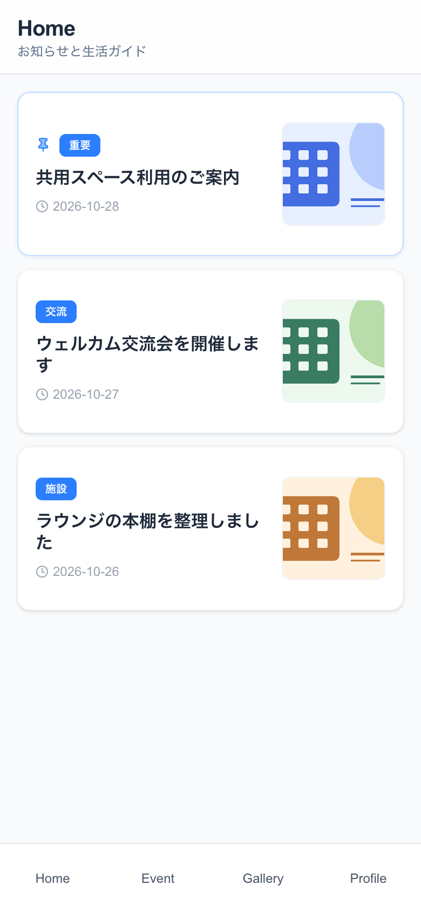
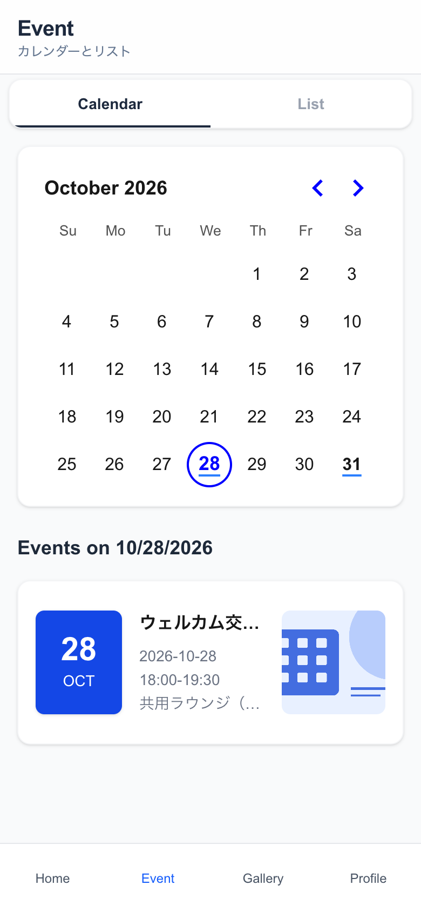
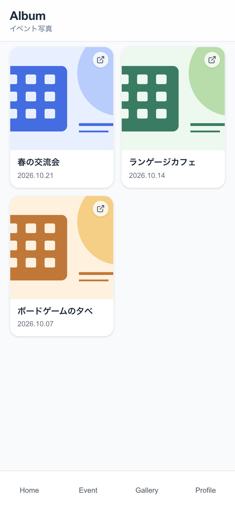
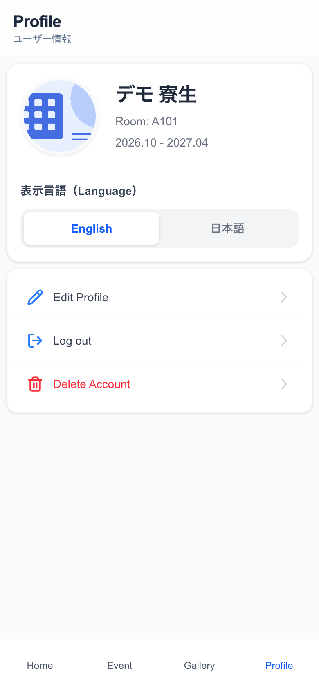
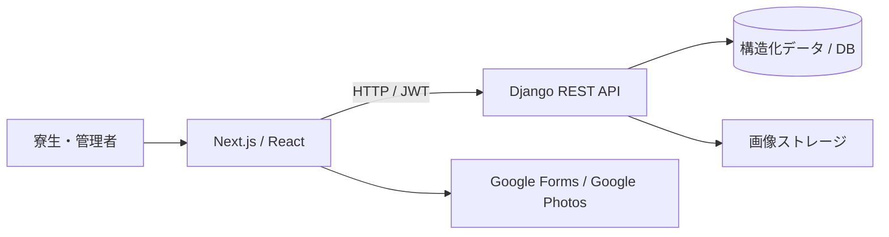

# Global Village Life

**大阪大学グローバルビレッジ津雲台での利用を想定した、寮生活の情報共有Webアプリ。**

お知らせ、交流イベント、写真アルバムを一つの画面導線にまとめ、寮生が情報を確認し、管理者が更新できる仕組みを個人で制作しました。

> **開発中断・公開停止中のプロトタイプです。** レジデントチューターとして働きながら4月から運用する計画でしたが、予定していた運用体制が成立しなかったため、導入前に開発を中断しました。利用していたクラウドサービスは、不要な環境を残さない方針で解約済みです。

## 画面

実際のNext.js画面を、ローカルのDjango API・SQLiteに接続して撮影しています。氏名・部屋番号・お知らせ・イベントはすべて架空で、画像もデモ用の図案です。実際の寮の行事・写真や、運用実績を示すものではありません。

| お知らせ | イベントカレンダー |
| --- | --- |
|  |  |
| 写真アルバム | プロフィール |
|  |  |

[イベント詳細](docs/screenshots/event-detail.png) ／ [管理者のお知らせ作成画面](docs/screenshots/admin-notice.png)

## 制作背景と担当範囲

グローバルビレッジ津雲台のレジデントチューターとして、寮生活を支える活動と並行して運用することを目指して制作しました。対象は寮生と、情報を発信する管理者です。

要件の検討、全体構成の検討、データモデル、バックエンドAPI、フロントエンド画面を一人で制作しました。当初のアプリ実装ではCodex・Claude Codeなどのコーディングエージェントを使用していません。公開用README、ローカルデモ環境、スクリーンショット、型の補正は、その後のポートフォリオ整備としてCodexを利用して追加しています。

特に難しかったのは、コードを書く前の「何を機能として提供するか」と「管理者にどのように導入を提案するか」の検討です。要件を画面と操作に落とし込むこと、データベースと画像ストレージの役割を分けて全体構成を考えることに取り組みました。本作品では、機能実装に加えて、利用者と運用者の両方を考えてサービスを組み立てた過程を紹介しています。

## 実装した機能

| 機能 | 内容 |
| --- | --- |
| アカウント | メールアドレスによる登録・有効化、JWTログイン、パスワード再設定 |
| お知らせ | 一覧・詳細、カテゴリ、固定表示、最大3枚の画像。管理者は作成・編集・削除 |
| イベント | カレンダー／リスト表示、日付別の一覧、詳細。管理者は画像付きイベントを作成 |
| 参加案内 | イベントに設定したGoogle Formsへの外部リンク |
| ギャラリー | アルバムのカバー画像・開催日を表示し、確認画面を経てGoogle Photosへ移動 |
| プロフィール | 氏名・アイコンの編集、部屋番号・入退寮年月の表示、ログアウト、アカウント削除 |
| 権限 | `Resident` と `Admin` を分け、投稿操作をAPI側でも制限 |

Google Forms・Google Photosとの連携は共有URLへのリンクです。参加者管理や写真の同期をアプリ内で行う実装ではありません。

## 設計で考えたこと

### 利用者と管理者の操作を分ける

寮生には閲覧・プロフィール操作を、管理者には投稿操作を提供します。フロントエンドはユーザー情報から管理用ボタンを表示し、バックエンドでも `IsRoleAdmin` によって書き込み権限を確認します。Django管理画面の権限 `is_staff` とアプリ内の `role` は別に扱っています。

### データベースと画像の保存先を分ける

ユーザー、お知らせ、イベントなどの構造化データはDBで管理し、画像ファイルはCloudflare R2へ保存する構成にしました。お知らせ・イベントと添付画像は別モデルにして、複数画像を扱います。画像名にはUUIDを用いています。

今回追加したローカルデモでは、同じAPIとモデルを使いながら、保存先だけをSQLiteとローカルファイルへ切り替えます。

### 既存サービスを使って実装範囲を絞る

イベントの参加受付はGoogle Forms、アルバムの写真閲覧はGoogle Photosへのリンクを使います。アプリ側では、お知らせとイベントを探すこと、必要な外部ページへ移動することを実装しました。

### 日本語・英語の情報を保持する

お知らせ・イベントには日本語／英語のタイトルと本文を設けています。一方、画面全体の言語切り替えは未完成です。データの保持と、UIとして利用できる範囲を分けて記録しています。

## 技術構成

| 領域 | 技術 |
| --- | --- |
| UI | Next.js 16.1.2 / React 19.2.3 / TypeScript / Tailwind CSS 4 |
| 画面部品 | react-day-picker / date-fns / lucide-react / react-hot-toast |
| API | Django / Django REST Framework |
| 認証 | Djoser / Simple JWT / メールアドレスを使うカスタムユーザー |
| 旧クラウド構成 | Vercel（フロント）、Cloud Run（API）、Cloudflare R2（画像）。現在は解約済み |
| DB接続 | 通常設定では `DATABASE_URL` で指定。デモではSQLite |
| ローカルデモの検証環境 | Python 3.12.14 / Django 6.0.9 / Node.js 22.23.4 / npm 10.9.9 |



ローカルデモでは、DBは `backend/demo.sqlite3`、画像保存先は `backend/demo-media/` です。旧クラウド環境に接続する必要はありません。

## ローカルで試す

Python 3.12とNode.js 22、npmを用意してください。依存パッケージの取得と、Next.jsのビルド時のGoogle Fonts取得にはネット接続が必要です。クラウドサービスのアカウントやAPIキーは不要です。

### 1. バックエンドを起動する

リポジトリのルートから実行します。以下はmacOS / Linux向けです。

```bash
python3.12 -m venv .venv
source .venv/bin/activate
python -m pip install -r backend/requirements-demo.txt
cd backend
export LOCAL_DEMO=1
python manage.py migrate
python manage.py seed_demo
python manage.py runserver 127.0.0.1:8000
```

`LOCAL_DEMO=1` のときだけ、専用のDB・ローカル画像保存・開発用キーを使用します。既存の `.env` にDBやR2の設定があっても、デモモードではそれらに接続しません。デモ用アカウントと固定キーを含むため、このモードは外部公開せずループバックで利用してください。

`seed_demo` は架空のお知らせ・イベント・アルバム・初期タグと、以下の有効化済みアカウントを作成します。再実行すると同じデモ項目を更新し、デモアカウントのパスワードも下記の値に戻します。通常モードでは実行を拒否します。

| 用途 | メールアドレス | ローカルデモ専用パスワード |
| --- | --- | --- |
| 寮生 | `resident@example.com` | `LocalDemo2026!` |
| 管理者 | `admin@example.com` | `LocalDemo2026!` |

### 2. フロントエンドを起動する

別のターミナルでリポジトリのルートから実行します。

```bash
cd frontend
npm ci
cp .env.example .env.local
npm run dev -- --hostname 127.0.0.1
```

[http://localhost:3000](http://localhost:3000) を開き、デモアカウントでログインします。管理者でログインすると右下に投稿ボタンが表示されます。Django管理画面は [http://localhost:8000/admin/](http://localhost:8000/admin/) です。

`localhost` と `127.0.0.1` の混在によるCookie・CORSの差を避けるため、ブラウザでは `localhost` を使ってください。終了は各ターミナルで `Ctrl+C`。同じターミナルで通常設定へ戻す場合は `unset LOCAL_DEMO` を実行します。

デモのギャラリーに入れた外部URLは `https://example.com/` です。実際のGoogle Photosアルバムには接続しません。追加登録・パスワード再設定のメールは送信されず、バックエンドのターミナルに確認リンクが出力されます。

## リポジトリ構成

```text
backend/
  accounts/                  ユーザー、権限、デモデータ作成コマンド
  contents/                  お知らせとタグ
  events/                    イベントと画像
  gallery/                   アルバム情報
  config/                    Django設定とルーティング
  requirements-demo.txt      ローカルで検証した依存関係
frontend/
  src/app/                   認証画面とダッシュボード
  src/contexts/              ログインユーザー情報の共有
  src/middleware.ts          ダッシュボードへのアクセス制御
docs/screenshots/            実画面のキャプチャ
scripts/capture_screenshots.py  撮影と基本画面遷移の確認
```

[フロントエンドの開発ガイド](frontend/README.md)には画面一覧、API接続、認証の流れ、コマンドを記載しています。[撮影手順](docs/screenshots/README.md)から画面キャプチャを再現できます。

## 検証と残っている課題

ポートフォリオ整備時に、デモ用DBのマイグレーション、初期データ生成、Djangoのシステムチェック、フロントエンドの本番ビルド（Webpack）、型チェック、ログイン後の主要画面表示を確認しています。確認の範囲と撮影条件は[撮影手順](docs/screenshots/README.md)に記載しています。

開発を中断した段階のため、次の制約があります。

- JWTアクセストークンの有効期限は60分です。リフレッシュトークンは保存していますが、自動更新処理は未実装のため、期限切れ時は再ログインが必要です。
- 日本語／英語のデータ項目はありますが、画面全体の言語切り替えは未完成です。
- 一覧APIは20件単位のページネーションです。フロント側の次ページ読み込みは未実装です。
- イベントとギャラリーの編集・削除UI、生活ガイドの画面は未実装です。
- ダッシュボードはログインを要求しますが、お知らせ・イベント・ギャラリーの閲覧API自体は匿名GETを許可する実装です。
- アカウントの「退会」は論理的な無効化ではなく、ユーザーレコードの削除です。
- 既存のバックエンド `tests.py` は雛形です。包括的な自動テストやCIは整備していません。ESLintはエラー0件ですが、画像・未使用変数・Hooksに関する警告が残っています。
- 旧デプロイ用設定には `DEBUG=True` などの開発設定が残っています。再公開には設定・認証・依存関係の見直しが必要です。既存DockerfileのPython 3.11とバージョン未固定の依存関係は、今回のPython 3.12デモ環境とは別です。

実際の寮での導入実績はありません。実装済みの範囲と、再開時に取り組む課題を含めて公開しています。
